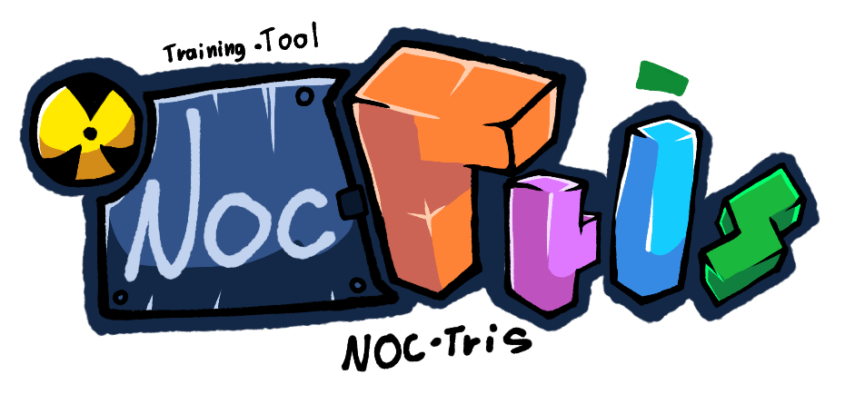
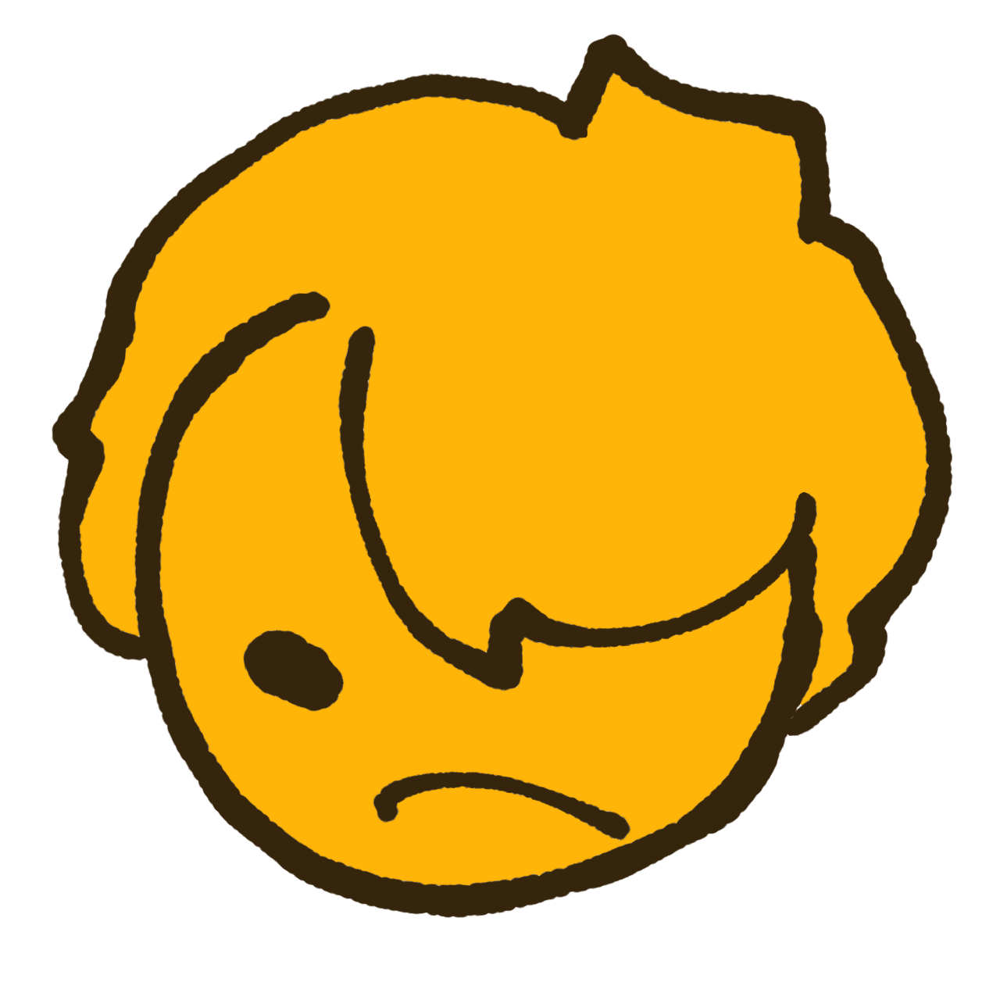
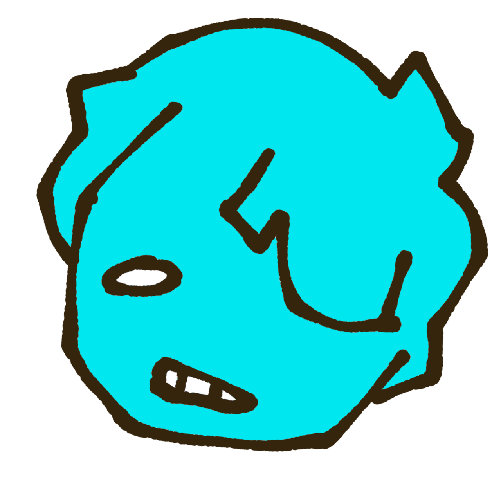
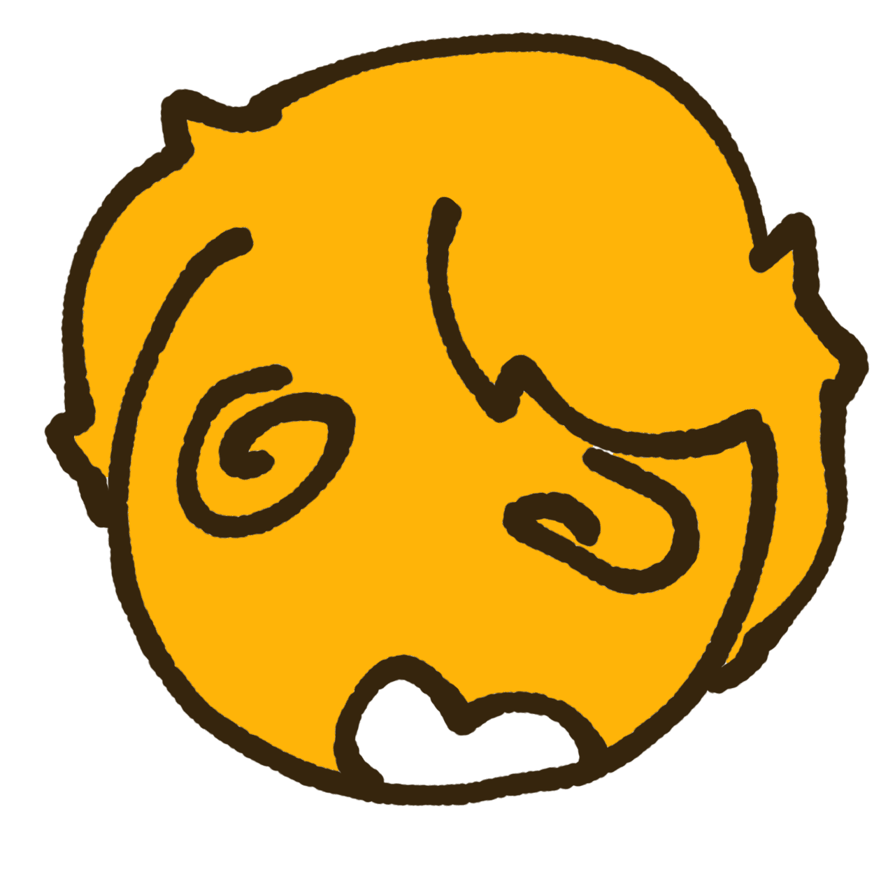

### Training tool

🟦🟦🟨🟨🟪🟪🟩🟩🟥🟥🟧🟧🟦🟦

> [!IMPORTANT]
> **Latest: N63.1.7.2 Beta.** Lamp and Defense got tweaks, and the lose rule is fixed.

---

## 🎨 Meet Nukie

<table>
<tr>
<td align="center"> <b>Nukie</b></td>
<td align="center"> <b>Angy</b></td>
<td align="center"> <b>Frozen</b></td>
<td align="center"> <b>Stunned</b></td>
</tr>
</table>

---

## 🆕 What's new in N63.1.7.2 Beta

### ✅ New

| | |
|---|---|
| 💡 **Lamp** | Fades for 2 seconds, stays hidden for 4 seconds, and the lamp now sits on the left |
| 🛡️ **Defense** | New speed slider with **Easy**, **Mid** and **Hard** |
| 🔗 **About** | Now lists GitHub - Nukie63 |

### 🐛 Bug fixes

- You now lose when the stack blocks where the next piece spawns, or when a piece locks above the board. **Red X marks** show where it was blocked

---

## 🧱 Also new since the last README: N63.1.7.1 Beta

<b>Show N63.1.7.1 Beta</b>

### ✅ New

- **New main menu** with **Solo**, **Training** and **Modes**
- Four-line clears now show **NocTris**, and five-line clears show **Petris**
- New icons for options, what's new, warnings and a mouse hint for the Lightning smoke
- Bots build T-spins and big clears instead of only singles and doubles

| 🏋️ Training | 🎮 Modes |
|---|---|
| Vs Bot | Nukie |
| Sandbox | Mutation (Petrominos) |
| Flood | Target |
| 4-Wide | Classic |
| Finesse | Lamp, with Invisible |
| Sprint | |
| Cheese | |
| Defense | |

### 🐛 Bug fixes

- Old updates moved to **Past updates**

### 🚧 Coming soon (WIP)

Spins, PCs, Local PvP, Zone and Bot Royale

---

## 🔗 Find Nukie

| Platform | Name |
|---|---|
| TETR.IO | Nukie63 |
| TikTok | nukie_63 |
| Discord | nukie-63 |
| X | Nukie63 |
| GitHub | Nukie63 |

---

## 📜 Disclaimer

> [!NOTE]
> I made this game with the help of Claude AI as a tool aights.

> [!WARNING]
> NocTris was made by **Nukie63**. Copying this game or claiming it as your own is not allowed.

🟦🟨🟪🟩🟥🟧🟦🟨🟪🟩🟥🟧

Made with 🧱 by Nukie63 · N63.1.7.2 Beta

